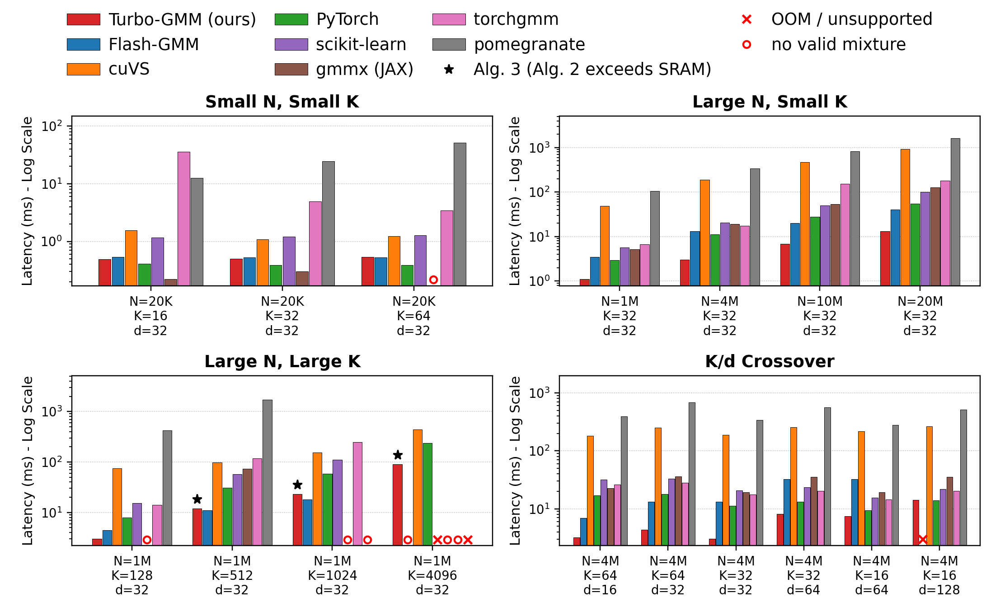

# Turbo-GMM

🚀 **(Arguably) the fastest GPU implementation of Gaussian Mixture Models (GMMs) as of November 2026.**

[]()

A drop-in replacement for `sklearn.mixture.GaussianMixture` that fits on the GPU.



## Install

```bash
bash env/setup-core.sh          # creates .venv-core: torch 2.6.0+cu124, triton 3.2.0
source .venv-core/bin/activate
```

## Usage

One line changes:

```python
# before
from sklearn.mixture import GaussianMixture
gm = GaussianMixture(n_components=8, covariance_type="diag").fit(X)

# after
from turbo_gmm import TurboGaussianMixture as GaussianMixture
gm = GaussianMixture(n_components=8, covariance_type="diag").fit(X)

labels = gm.predict(X)          # same attributes and methods as sklearn:
probs  = gm.predict_proba(X)    # weights_, means_, covariances_, precisions_,
ll     = gm.score(X)            # precisions_cholesky_, n_iter_, lower_bound_,
bic    = gm.bic(X)              # converged_, score_samples(), sample(), bic(), aic()
```

Nothing needs tuning: the defaults are the fast path.

`covariance_type` accepts `"diag"` and `"spherical"`; it raises for `"full"` and `"tied"`
rather than silently fitting a different model. `n_init > 1` raises — fit repeatedly with
different `random_state` and keep the best `lower_bound_`. Set `random_state` if you need
reproducible fits.

### Timing it yourself

```python
import time
import numpy as np
from sklearn.mixture import GaussianMixture as SklearnGMM
from turbo_gmm import TurboGaussianMixture

N, K, d, ITERS = 1_000_000, 128, 32, 20

rng = np.random.default_rng(0)
mu = rng.normal(0, 3, (8, d))
X = (mu[rng.integers(0, 8, N)] + rng.normal(0, 1, (N, d))).astype(np.float64)

# Same work on both sides: same initialization, no early stopping, a fixed iteration
# count. Without tol=0.0 the two stop after different numbers of iterations and the
# comparison measures convergence luck rather than speed.
common = dict(n_components=K, covariance_type="diag", init_params="random_from_data",
              random_state=0, max_iter=ITERS, tol=0.0)

t0 = time.perf_counter()
SklearnGMM(**common).fit(X)
t_cpu = time.perf_counter() - t0

t0 = time.perf_counter()
TurboGaussianMixture(**common).fit(X)
t_gpu = time.perf_counter() - t0

print(f"sklearn (CPU) {t_cpu:8.3f} s")
print(f"turbo_gmm     {t_gpu:8.3f} s     {t_cpu / t_gpu:6.1f}x faster")

# scikit-learn can also run on the GPU, via Array API dispatch on a CUDA tensor.
# It refuses init_params="kmeans" in that mode, which is why the block above uses
# random_from_data on both sides.
try:
    import os
    os.environ.setdefault("SCIPY_ARRAY_API", "1")
    import sklearn
    import torch

    t0 = time.perf_counter()
    with sklearn.config_context(array_api_dispatch=True):
        SklearnGMM(**common).fit(torch.asarray(X, dtype=torch.float32, device="cuda"))
        torch.cuda.synchronize()
    t_skgpu = time.perf_counter() - t0
    print(f"sklearn (GPU) {t_skgpu:8.3f} s     turbo_gmm is {t_skgpu / t_gpu:.1f}x faster")
except Exception as exc:                        # needs scikit-learn >= 1.8
    print(f"sklearn (GPU) unavailable: {exc}")
```

### Measured

`.fit(X)` end to end on one A100-SXM4-80GB, with the protocol in the block above:
same initialization on every arm, `tol=0.0`, 20 EM iterations, `covariance_type="diag"`,
best of three runs. `N` points, `K` components, `d` dimensions.

| N | K | d | sklearn (CPU) | sklearn (GPU) | turbo_gmm (GPU) | vs CPU | vs GPU |
|---:|---:|---:|---:|---:|---:|---:|---:|
| 1,000,000 | 128 | 32 | 79.1 s | 0.323 s | **0.106 s** | **746×** | **3.0×** |
| 4,000,000 | 64 | 16 | 167.2 s | 0.708 s | **0.143 s** | **1169×** | **5.0×** |
| 1,000,000 | 512 | 32 | 300.0 s | 1.133 s | **0.289 s** | **1038×** | **3.9×** |

The margin grows with `K`: the responsibility matrix that Turbo-GMM never writes is
`N × K`, so there is more to save the more components you fit. At small `K` — the
`n_components=8` of the snippet above — it is smaller than the data itself and the
GPU arms are within a factor of two of each other.

## Reproducing the paper

```bash
cd experiments
python plot_figure1.py            # Figure 1 from the recorded results
python plot_figure2.py            # Figure 2 from the recorded results
```

Both redraw the paper's figures from the recorded measurements in
`experiments/results/`. To re-measure from scratch on a GPU, and for the per-baseline
environments, see [`experiments/README.md`](experiments/README.md).


## Citation

If you find our work or this repository useful, please consider giving it a star ⭐ and citing our paper.

```bibtex
@article{abbas2026turbo,
  title={Turbo-GMM: FlashAttention-Inspired GPU-Accelerated Gaussian Mixture Model},
  author={Momin Abbas and Sadia Asif and Asad Ul Haq and Kaoutar El Maghraoui},
  year={2026},
  url={}
}
```

## Contact

Should you have any inquiries, feel free to reach out via email at momin_abbas@yahoo.com .

